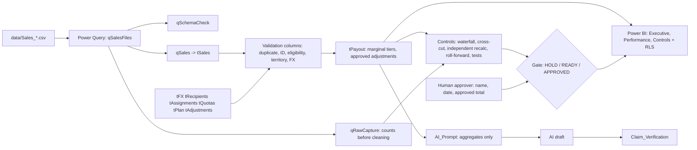

# SIC Intelligence Hub

**SYNTHETIC prototype** inspired by a Sales Incentive Compensation (SIC) intern role. It doesn't reflect GE HealthCare's plans, systems, people or data.

## Problem

Pay sales incentives correctly and on time, and be able to prove it. That means dirty source files, mid-month territory changes, plan changes, FX, adjustments, and a clear human sign-off.

## Architecture

Principle: **AI explains, Excel calculates, a human approves.**

## Contents

| Path | What |
|---|---|
| SIC_Intelligence_Hub.xlsx | The workbook. Start on the **Controls** sheet |
| data/ | Aug–Oct sales files (with 11 planted errors) |
| reference/ | Master tables as CSV |
| demo_hold_back/Sales_2026-11.csv | Next-month file for the refresh demo |
| docs/Formula_Reference.md | Every formula, generated from the workbook |
| docs/01–05 | Controls & tests, Power Query, Power BI, AI layer, interview kit |
| docs/SOP.md | Monthly cycle |
| JD_Mapping.pptx | One slide: job description → features |
| tools/ | Python used only to generate data and check results (not part of what you maintain) |

## How to run

1. Open the workbook in Excel 365. Read Controls: it should show **HOLD**, with one check failing (C8, 4 open High exceptions).
2. Work exceptions on the Exceptions sheet: Status = Closed with a Resolution.
3. When the status is READY FOR REVIEW, a second person types their name, the date, and the approved total (shown beside the cell).
4. Optional: set up Power Query (docs/02) and Power BI (docs/03).

## Verification status

| Area | Status |
|---|---|
| Calculation logic, controls, 18 tests, gate scenarios | **VERIFIED** (independent recalculation + hand-derived values) |
| Workbook in real Excel for Mac | **VERIFIED**: opens without repair, formulas calculate live, gate reacts live |
| Power Query (qSalesFiles, qRawCapture, qSchemaCheck) | **VERIFIED** in Excel for Mac; waterfall and Run_Log read qRawCapture |
| New-month demo (drop Sales_2026-11.csv, Refresh All) | **VERIFIED**: 4 files, 73 rows, waterfall variance 14, status HOLD; reset afterwards |
| Power BI | **VERIFIED** basic one-page report in Power BI service (My workspace, "SIC Intelligence Hub - Dashboard (synthetic)") |
| Exception_Log spill formula | Paste the formula from that sheet once in Excel 365 |
| RLS, multi-page Power BI model, Power Automate | Documented in docs/03 and docs/02, not built |
| Timing and AI pass rates | Not measured yet. Record real results only |

Start with **SIC_Intelligence_Hub_Guide.pdf** if you are new to the project.

## Assumptions

- Product families: AIS, PDx, PCS.
- Monthly average FX by transaction month.
- Late items are credited in the processing month.
- Credit notes net in the booking month.
- Payout region = region at period end.
- No proration.

## Limitations

See docs/05_Interview_Kit.md, section 2.
